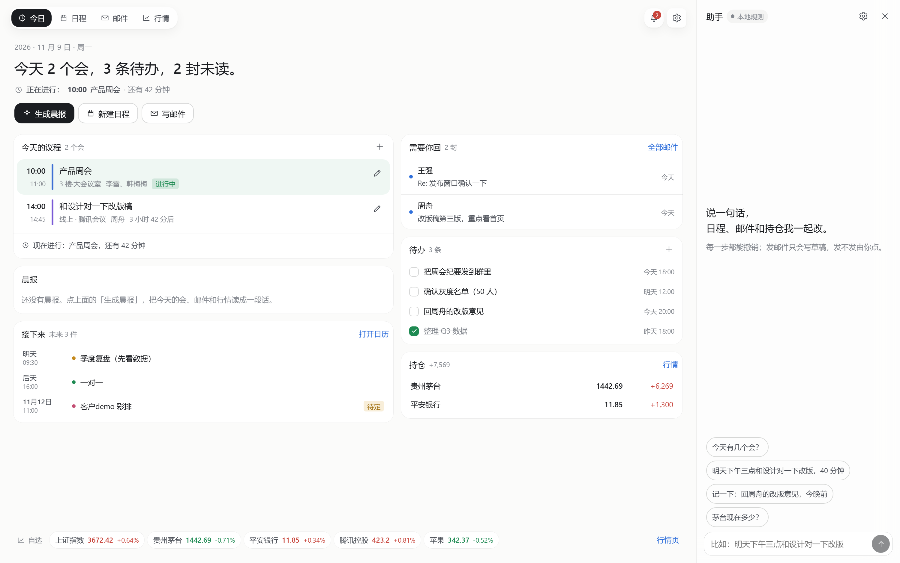

# 办公工作台

> DeepSeek Harness 的一个插件。日程、邮件、行情，加一份每天早上替你读完的晨报。

装在 DeepSeek Harness 侧栏里的一个整页面板。打开是**今天**：左边是议程和晨报，右边是等你回复的邮件和待办，底下是一条自选行情。

四个页面：**今日 · 日程 · 邮件 · 行情**。右侧是 **DSH 的那条会话**——同一条上下文，说一句话就改日程、记待办、写邮件草稿。

和 DSH 的联动是双向的：

- 在 **DSH 对话**里说「明天下午三点和设计对一下改版，40 分钟」，Agent 会调用 `work_desk_calendar` 直接写进工作台，日程页立刻多一块。
- 在 **工作台右侧**说话，进的是同一条会话；Agent 的回复和工具调用（`work_desk_task` 之类）实时显示，工作台同步刷新。
- 会话里聊出「明天四点半和运营过方案」这种安排时，那条回复下面会出现 **「落到工作台」**，点一下就让同一条会话去调工具落地——不用你再复述一遍。



<sub>日程 · 邮件 · 行情：[日历](docs/shot-calendar.png) · [邮件](docs/shot-mail.png) · [行情](docs/shot-market.png)</sub>

架构参考 [dsh-media-desk](https://github.com/woniuniuniu/dsh-media-desk)（我做的自媒体工作台），把这个"创作台"改成了"办公台"。设计取舍写在 [设计说明.md](./设计说明.md)。

---

## 它解决什么

| 原来 | 现在 |
|---|---|
| 早上要开三个 App 才能知道今天怎么过 | 一段晨报：先做什么、要回谁、盘中留意什么 |
| 会撞了你到现场才发现 | 周视图里并排显示，标"冲突" |
| 邮件看完忘了回 | 未读直接进"需要你回"，一键转待办/日程 |
| 持仓要另开行情软件 | 自选条常驻，阈值越过出现在提醒里 |
| "明天下午三点和设计对一下" 要开日历点六下 | 跟助手说一句 |

---

## 功能

**今日**
- 一行大字：今天几个会、几条待办、几封未读
- 下一件是什么，还有几分钟
- 晨报：有模型写人话，没模型按模板拼（会注明来源）
- 今日议程时间轴，进行中的会高亮 + 剩余分钟
- 需要你回、待办勾选、自选行情条
- 右侧是 DSH 会话镜像：读同一条会话、发消息直接进会话，Agent 用 `work_desk_*` 工具改工作台

**日程**
- 周视图为主（08:00–21:00），月视图做全局
- 拖动会议改时间（15 分钟吸附），空白处点一下按那个时间新建
- 冲突自动并排 + 标"冲突"；首尾相接不算冲突
- ICS 导入 / 导出，按 `UID` 去重，能导进企业微信、飞书、手机日历

**邮件**
- 三栏：筛选 / 列表 / 阅读
- 未读、星标、草稿；**可以直接复用 DSH 里已经配好的邮箱（dsh-email 插件）**，也可以自建 IMAP，或先用示例邮箱试
- 复用插件时，工作台只调它的读信/标记/写草稿工具：不读授权码，发送留在它的草稿箱里由你确认
- 回复走草稿 → **二次确认才发出**；没配 SMTP 会直说
- 一键转日程（带备注）、转待办
- 正文按纯文本渲染，不加载远程图片

**行情**
- 自选 + 持仓，A 股 / 指数 / 港股 / 美股
- 分时图（手写 SVG）、涨跌幅、成交量
- 持仓市值与浮动盈亏
- 阈值提醒（涨/跌超过 N%），越过就出现在今日页的铃铛里
- 免责声明常驻：数据来自腾讯公开行情，仅供参考

---

## 安装

要求 DeepSeek Harness `0.2.1-rc.5` 及以上的 `0.2.x`。

```bash
# 网页版
dsh plugin --profile web add dsh-work-desk

# 桌面版（先完全退出再装）
dsh plugin --profile desktop add dsh-work-desk
```

离线安装：`npm pack` 出 `dsh-work-desk-0.1.0.tgz`，把包名换成 `"file:$PWD/dsh-work-desk-0.1.0.tgz"`。

装好后侧栏出现「办公工作台」。第一次看到的都是示例数据，右上角可以一键清空。

如果你已经装了 `dsh-email` 并配好邮箱，进「设置 → 邮件」把来源切成 **DSH 邮件插件** 就能直接读信——工作台不需要你再填一遍授权码。

---

## 要花钱吗

插件免费开源，不带任何密钥。

| 用到什么 | 用什么 | 没配会怎样 |
|---|---|---|
| 日程、待办、导入导出 | 插件自己 | — |
| 晨报、助手 | DeepSeek Harness 里已配好的模型 | 退回本地规则和模板晨报 |
| 行情 | 腾讯公开行情 | 与 A 股/港股/美股代码无关 |
| 邮件 | 你自己的 IMAP/SMTP（授权码） | 用示例邮箱，发信按钮会提示未配置 |

---

## 设置

**邮件**：三种来源。

1. **DSH 邮件插件**（推荐，装了 `dsh-email` 就有）：账号、授权码、同步都在那个插件里，工作台只通过它的工具读信、改标记、写草稿。发信按钮会变成「存为草稿」——真正的发送在 `设置 → 邮件 → 草稿` 里由你确认。
2. **自建 IMAP / SMTP**：挑一个常用邮箱预填服务器，填邮箱地址和授权码。QQ / 163 要的是**授权码**不是登录密码；Gmail 要应用专用密码。
3. **示例邮箱**：不连网，先看看界面。

「测试连接」只登录 + 列文件夹，不发信。授权码只写进本机 `~/.dsh/work-desk/settings.json`（权限 600），不回传给浏览器，也不进内容数据。

**行情**：开关 + 刷新间隔（默认 8 秒）。

授权码只写进本机 `~/.dsh/work-desk/settings.json`（权限 600），不回传给浏览器，也不进内容数据。

---

## 数据存在哪

全在本机 `~/.dsh/work-desk/`：`state.json`（日程/待办/邮件/自选/持仓/晨报/对话）和 `settings.json`。桌面版和网页版共用同一份。卸载插件不会删。

---

## 开发

```bash
npm install
npm run watch                # 改 client/ 自动重打包
npm test                     # 68 个 Host 用例
node scripts/live-check.mjs  # 真网联调（会访问腾讯行情）
npm run build                # 产出 dist/client.js
```

| 目录 | 内容 |
|---|---|
| `client/` | 界面：今日、日程、邮件、行情、对话、设置 |
| `src/` | Host 接口、ops 白名单、行情、IMAP/SMTP/MIME、晨报、提示词、存储 |
| `test/` | ops / quotes / mime / calendar / API 冒烟 |
| `scripts/` | 打包、真网联调 |

改了 `src/` 要重启 DeepSeek Harness；只改 `client/` 用 `npm run watch` + 刷新页面。

---

## 已知限制

- 附件只列清单不下载；邮件不能移动/归档；不支持 IDLE 推送和 OAuth2。
- 复用 dsh-email 时，发信必须回 DSH 的草稿箱确认（这是有意的边界）；它没装或不支持直接调用工具时，退回自建 IMAP 或示例邮箱。
- 重复日程（RRULE）只导入第一条；跨时区的 `TZID` 按本机时区读。
- 只支持单邮箱账户；日历是导入导出，不做双向同步。
- 不做复权、分红送股，持仓是"看个大概"，不是账本。

详见 [设计说明.md](./设计说明.md) 第 14 节。

---

MIT。行情数据来自腾讯公开接口，仅供参考，不构成投资建议。
